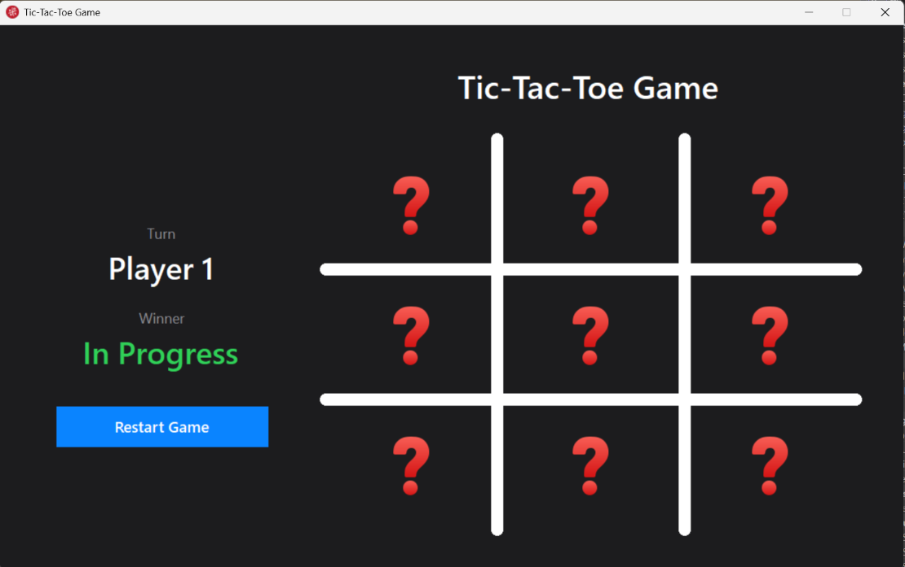
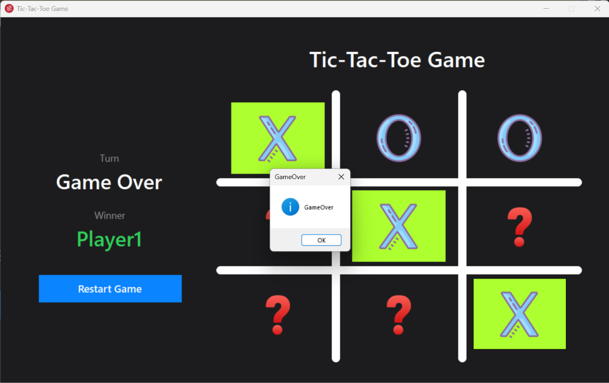

# Tic-Tac-Toe — C# Windows Forms Game

A modern, dark-themed **Tic-Tac-Toe** desktop game for two players on the same computer, built with **C#** and **Windows Forms** on **.NET Framework 4.8**.



## Features

- **Two-player local mode**: Player 1 plays **X**, Player 2 plays **O**
- **Live status panel** showing whose turn it is and the current game result
- **Win detection** across all 8 possible lines (3 rows, 3 columns, 2 diagonals)
- **Winning line highlight**: the three winning cells are highlighted in green
- **Draw detection** when the board is full and nobody has won
- **Move validation**: occupied cells can't be played again, and the board is locked once the game ends
- **One-click restart** to clear the board and start a new round
- **Custom-drawn board grid** using GDI+ with smooth, rounded lines
- Clean dark UI with flat buttons and hover effects

## Screenshots

**Game over:** Player 1 wins with the diagonal, and the winning cells are highlighted.



## Tech Stack

| | |
|---|---|
| Language | C# |
| UI framework | Windows Forms (WinForms) |
| Runtime | .NET Framework 4.8 |
| Graphics | GDI+ (`System.Drawing`) |
| IDE | Visual Studio 2022 |

## Getting Started

### Run the game

1. Clone the repository.
2. Open `TicTacToe.sln` in Visual Studio.
3. Press **F5** (or **Start**) to build and run.


## How to Play

1. Player 1 (**X**) starts. Click any **?** cell to place your mark.
2. Players take turns. The panel on the left shows whose turn it is.
3. The first player to get three marks in a row, column or diagonal wins, and the winning line is highlighted.
4. If all nine cells are filled without a winner, the game ends in a draw.
5. Click **Restart Game** to play again.

## How It Works

- **One shared event handler:** all nine board cells are `Button` controls wired to a single `Cell_Click` handler. The clicked cell comes from the `sender` argument, so there are no nine near-identical handlers.
- **Cell state in `Tag`:** each button stores its state (`"?"`, `"X"` or `"O"`) in its `Tag` property, which keeps the board state attached to the UI element itself.
- **Data-driven win check:** the eight winning lines are defined once as an array of button triples, and `CheckForWinner()` loops through them instead of repeating a separate check per line.
- **Game state:** small `Player` and `GameResult` enums together with a move counter track the turn, the result and draw conditions.
- **Custom painting:** the board grid is drawn in the form's `Paint` event with a thick white `Pen` using rounded line caps.

## Project Structure

```
TicTacToe-WinForms/
├── TicTacToe.sln                  # Visual Studio solution
├── TicTacToe/
│   ├── Program.cs                 # Application entry point
│   ├── MainForm.cs                # Game logic and event handlers
│   ├── MainForm.Designer.cs       # UI layout (generated by the WinForms designer)
│   ├── MainForm.resx
│   ├── Properties/                # Assembly info, resources, settings
│   ├── Resources/                 # X, O and empty-cell images and the app icon
│   ├── App.config
│   └── TicTacToe.csproj
└── docs/
    └── screenshots/               # Images used in this README
```
